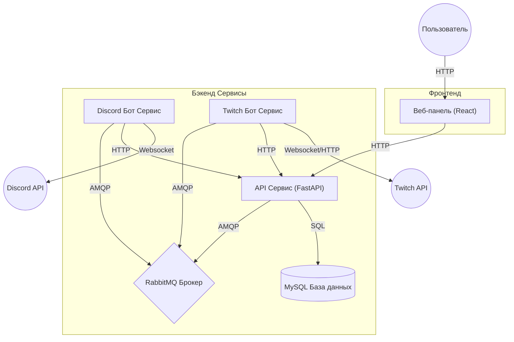

# Архитектура Системы

PRMajesticBot следует микросервисной архитектуре, разработанной для масштабируемости и четкого разделения обязанностей.

## 🏗️ Общий обзор

Система состоит из трех независимых бэкенд-сервисов и одного фронтенд-приложения. Межсервисное взаимодействие осуществляется через HTTP (синхронно, запрос/ответ) и RabbitMQ (асинхронно, событийно-ориентированно).

## 🧩 Сервисы

### 1. API Сервис (`services/api`)
**Роль:** Центральный узел и источник данных
- **Стек технологий:** Python 3.12, FastAPI, aiomysql (нативный SQL), Uvicorn.
- **Обязанности:**
  - Управляет подключением к базе данных MySQL и миграциями.
  - Предоставляет RESTful эндпоинты для других сервисов и фронтенда.
  - Обрабатывает бизнес-логику для Пользователей, Гильдий, Стримеров, Событий и Ассистентов.
  - Генерирует JWT токены для аутентификации.

### 2. Discord Бот Сервис (`services/discord_bot`)
**Роль:** Взаимодействие с пользователем и уведомления
- **Стек технологий:** Python 3.12, Disnake (обертка Discord API).
- **Обязанности:**
  - Обрабатывает слэш-команды (`/setup`, `/add_streamer` и т.д.). (Команды будут убраны в будущем, за исключением `/setup`)
  - Рендерит UI компоненты (Кнопки, Модальные окна, Эмбеды).
  - Прослушивает события от RabbitMQ (например, конкретный стример вышел в эфир) и отправляет уведомления в каналы Discord.
  - Общается с API сервисом для получения/сохранения данных.

### 3. Twitch Бот Сервис (`services/twitch_bot`)
**Роль:** Мониторинг стримов и получение событий
- **Стек технологий:** Python 3.12, TwitchIO.
- **Обязанности:**
  - Подключается к Twitch API и слушает изменения статуса стрима (В эфире/Оффлайн, Изменение категории).
  - Публикует сырые события в RabbitMQ (`stream.online`, `stream.offline`).
  - НЕ ИМЕЕТ прямого доступа к базе данных; полагается на API сервис для получения списка стримеров для мониторинга.

### 4. Веб-панель (`web`)
**Роль:** Административная панель управления
- **Стек технологий:** React, Vite, TailwindCSS.
- **Обязанности:**
  - Предоставляет визуальный интерфейс (в будущем) для управления ботом без использования команд Discord.

## 📡 Паттерны коммуникации

### Синхронный (HTTP REST)
Используется, когда сервису нужны немедленные данные или подтверждение.
- **Discord Bot -> API**: "Получить настройки для Гильдии X", "Добавить нового стримера".
- **Twitch Bot -> API**: "Получить список стримеров для мониторинга".

### Асинхронный (RabbitMQ)
Используется для распространения событий и декуплинга.
- **Exchange**: `prmajesticbot` (Topic)
- **Routing Keys**:
  - `stream.online`: Стример вышел в эфир.
  - `stream.offline`: Стример закончил трансляцию.
  - `stream.update`: Изменилось название стрима или категория.
  - `streamer.verify`: Запрос на верификацию Twitch канала.
  - `guild.settings.update`: Настройки изменены в Dashboard.

**Пример потока событий (Стример выходит в эфир):**
1. **Twitch Bot** обнаруживает событие "Stream Up" через Twitch API.
2. **Twitch Bot** публикует сообщение в RabbitMQ: routing key `stream.online`.
3. **Discord Bot** (подписчик) получает сообщение.
4. **Discord Bot** проверяет свой внутренний кэш или запрашивает API для получения настроек гильдии (Канал уведомлений).
5. **Discord Bot** форматирует сообщение и отправляет его в Discord.

## 💾 Модель Данных

Схема базы данных управляется через **Native SQL** в `services/api/database.py`. Бот автоматически проверяет и инициализирует таблицы при запуске.

> [!NOTE]
> Схема базы данных в настоящее время находится в активной разработке. Таблицы могут быть изменены и объединены в будущих обновлениях для оптимизации производительности и уменьшения избыточности.

**Текущие Таблицы:**
- `streamers`: Информация о Twitch каналах (имя, статус, приоритет, ставки).
- `settings`: Глобальные конфигурации/конфигурации гильдий (каналы, шаблоны).
- `users`: Доступ к Dashboard и аутентификация.
- `assistants`: Связанные пользователи Discord для функций ассистента PR.
- `specs`: Активные сессии наблюдения (живые данные).
- `daily_stats`: Агрегированная историческая статистика для ассистентов.
- `events`: Внутреннее управление событиями.
- `event_participants`: Отслеживание участия пользователей в событиях.
- `sessions` & `auth_logs`: Отслеживание аутентификации веб-панели.
- `command_logs`: Лог аудита для команд бота.

## 🛠️ Принципы Разработки

- **Разделение обязанностей**: Каждый сервис имеет одну ответственность.
- **Единый источник истины**: База данных/API является хозяином данных. Боты не должны поддерживать сложное локальное состояние.
- **Устойчивость**: Сервисы должны корректно обрабатывать сбои подключения (API/RabbitMQ) с повторными попытками.
- **Изоляция окружения**: Каждый сервис имеет свой собственный файл `.env` и класс конфигурации.
