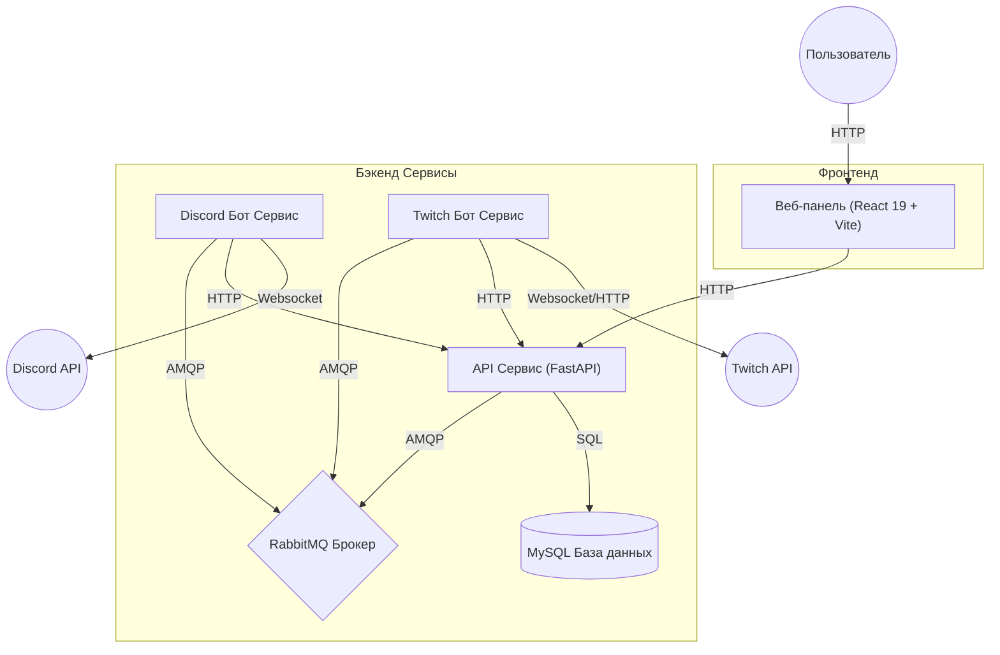

# Архитектура Системы

PRMajesticBot — это микросервисная система для мониторинга стримеров и управления PR-активностью, разработанная для масштабируемости и четкого разделения обязанностей.

## 🏗️ Общий обзор

Система состоит из трех независимых бэкенд-сервисов и одного фронтенд-приложения. Межсервисное взаимодействие осуществляется через HTTP (синхронно, запрос/ответ) и RabbitMQ (асинхронно, событийно-ориентированно).

## 🧩 Сервисы

### 1. API Сервис (`services/api`)
**Роль:** Центральный узел и источник данных
- **Стек технологий:** Python 3.12+, FastAPI, aiomysql (нативный SQL), Uvicorn.
- **Обязанности:**
  - Управляет подключением к базе данных MySQL и миграциями.
  - Предоставляет RESTful эндпоинты для других сервисов и фронтенда.
  - Обрабатывает бизнес-логику для Пользователей, Гильдий, Стримеров, Событий и Ассистентов.
  - Генерирует JWT токены для аутентификации.

### 2. Discord Бот Сервис (`services/discord_bot`)
**Роль:** Взаимодействие с пользователем и уведомления
- **Стек технологий:** Python 3.12+, Disnake (обертка Discord API).
- **Обязанности:**
  - Обрабатывает слэш-команды (`/setup`, `/add_streamer` и т.д.).
  - Рендерит UI компоненты (Кнопки, Модальные окна, Эмбеды).
  - Прослушивает события от RabbitMQ (например, `stream.online`, `stream.offline`) и отправляет уведомления.
  - Общается с API сервисом для получения/сохранения данных.

### 3. Twitch Бот Сервис (`services/twitch_bot`)
**Роль:** Мониторинг стримов и получение событий
- **Стек технологий:** Python 3.12+, TwitchIO.
- **Обязанности:**
  - Подключается к Twitch API и EventSub для отслеживания изменений статуса стрима.
  - Обновляет статус стримеров через центральный API.
  - **НЕ ИМЕЕТ** прямого доступа к базе данных.
  - Использует RabbitMQ (через API Service или напрямую) для распространения событий.

### 4. Веб-панель (`web`)
**Роль:** Административная панель управления
- **Стек технологий:** React 19, Vite, TailwindCSS v4, TypeScript.
- **Обязанности:**
  - Предоставляет визуальный интерфейс для управления ботом, стримерами и событиями.
  - Взаимодействует с API для получения данных и выполнения команд.

## 📡 Паттерны коммуникации

### Синхронный (HTTP REST)
Используется, когда сервису нужны немедленные данные или подтверждение.
- **Discord Bot -> API**: "Получить настройки для Гильдии X", "Добавить нового стримера".
- **Twitch Bot -> API**: "Получить список стримеров", "Обновить статус стрима".
- **Web -> API**: Все операции Dashboard.

### Асинхронный (RabbitMQ)
Используется для реакции на события в реальном времени.
- **Exchange**: `prmajesticbot` (Topic)
- **Routing Keys**:
  - `stream.online`: Стример вышел в эфир.
  - `stream.offline`: Стример закончил трансляцию.
  - `stream.update`: Изменилось название стрима или категория.
  - `guild.settings.update`: Настройки изменены в Dashboard.

## 💾 Модель Данных

Схема базы данных управляется через **Native SQL** в `services/api/database.py`. Таблицы автоматически проверяются при запуске API.

**Основные таблицы:**
- `streamers`: Информация о Twitch каналах (статус, игра, приоритет, привязка к PR).
- `settings`: Глобальные настройки гильдии (каналы уведомлений, роли).
- `assistants`: Сотрудники (PR) и их текущие назначения.
- `spec_sessions`: История сессий наблюдения (кто, кого, сколько времени смотрел).
- `daily_stats`: Агрегированная статистика работы ассистентов.
- `events`: Внутренние события, требующие наблюдения.
- `web_auth`: Пользователи веб-панели (логин/пароль/хеш).
- `sessions` & `auth_logs`: Безопасность и история входов в панель.
- `role_permissions`: Настройки прав доступа для ролей (junior, employee, manager и т.д.).
- `admin_logs`: Аудит действий администраторов.

Актуальные детали контракта auth/stats:
- Access token содержит `sid` (ID записи в `sessions`) и валидируется против активной сессии.
- После logout сессии ревокируются, и старые access token больше не проходят проверку.
- Клиенты получают число активных спеков через `/api/stats/dashboard` (`assigned_pr_count`).

## 🔐 Ролевая Модель (RBAC)

Система поддерживает динамические права доступа, хранящиеся в `role_permissions`.
Стандартные роли:
- **Junior Employee**: Только просмотр Dashboard и базовый спек.
- **Employee**: Стандартные функции.
- **Senior Employee**: Расширенные права.
- **Manager**: Управление ивентами, стримерами и пользователями.
- **Developer**: Полный доступ ко всем функциям и логам.

## 🛠️ Принципы Разработки

- **Микросервисы**: Четкое разделение ответственности.
- **Единый источник правды (API + DB)**: Боты не хранят сложное состояние.
- **Отказоустойчивость**: Механизмы Retry для DB и RabbitMQ.
- **Типизация**: Использование Pydantic для валидации данных и TypeScript на фронтенде.
